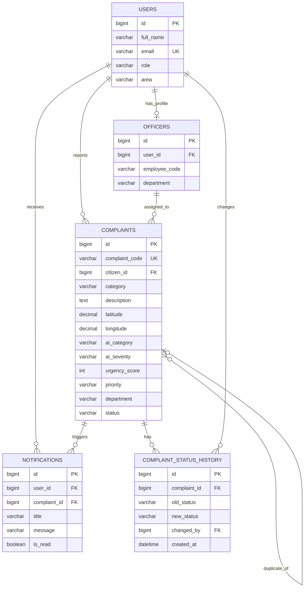
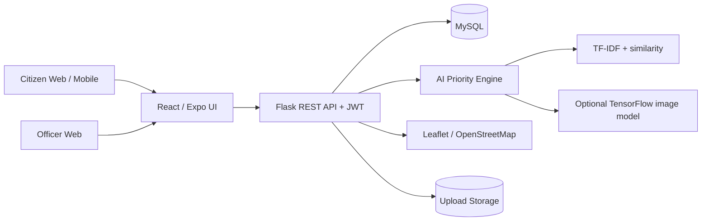
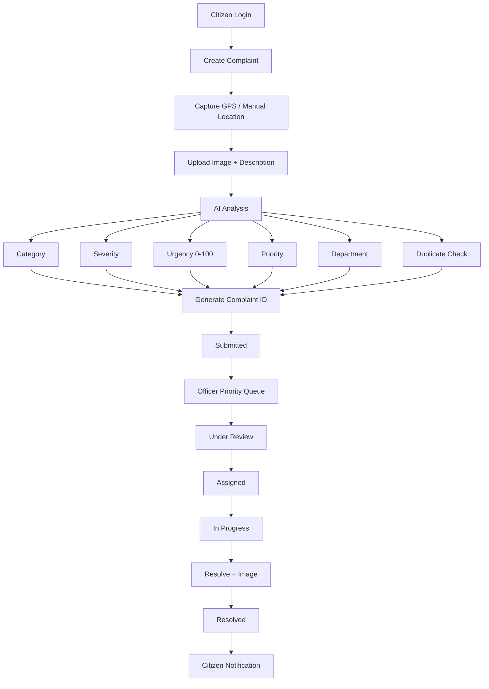
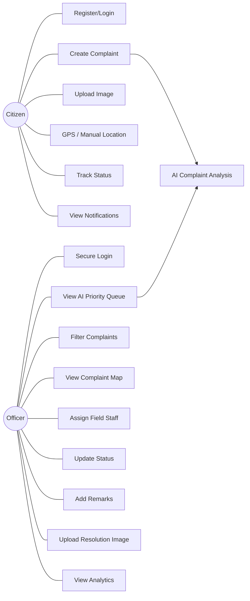
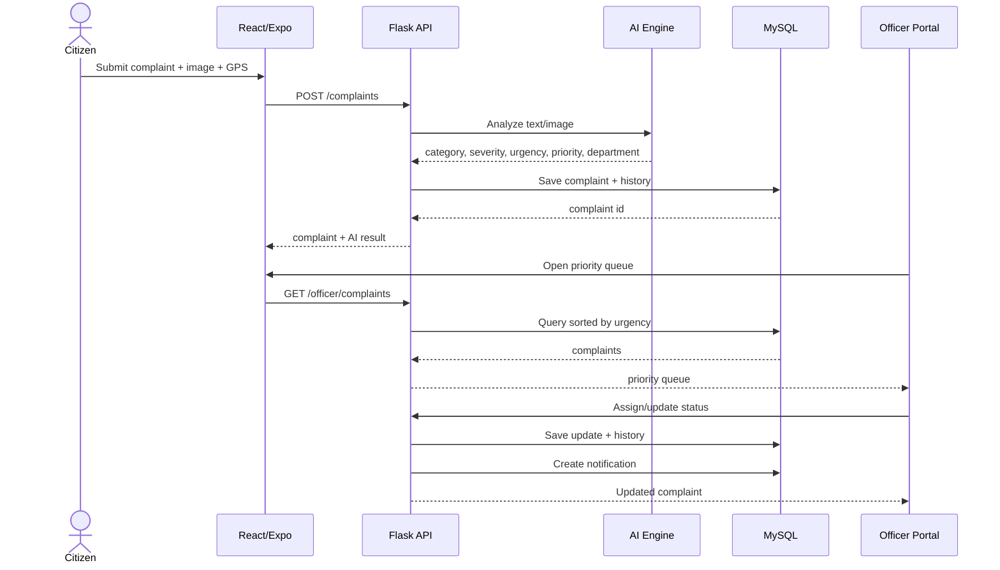
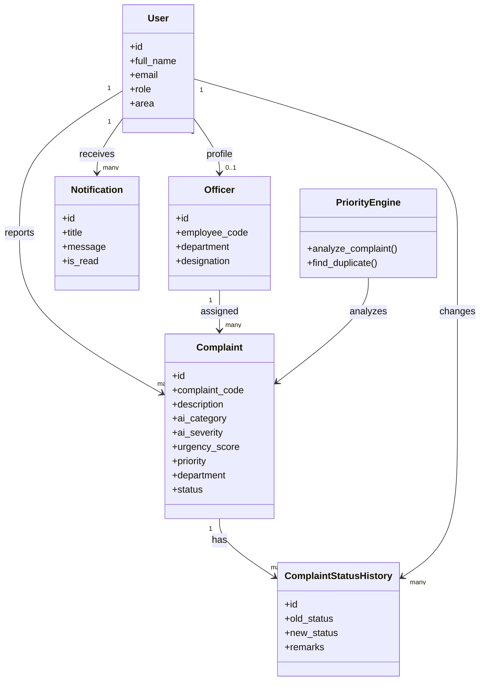
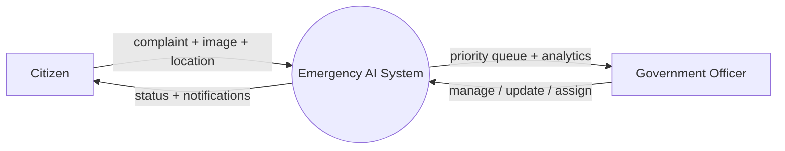
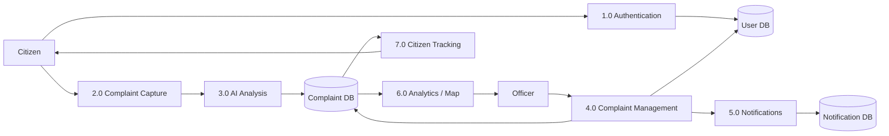

# Emergency AI – CSP Diagrams

All diagrams below are written in Mermaid so they can be rendered in Markdown-compatible editors and Mermaid Live.

## 1. ER Diagram

## 2. System Architecture

## 3. Flowchart – Complaint Lifecycle

## 4. Use Case Diagram

## 5. Sequence Diagram

## 6. Class Diagram

## 7. DFD Level 0 – Context Diagram

## 8. DFD Level 1

## 9. Project Modules

1. Authentication & Role Management
2. Citizen Complaint Management
3. AI NLP Classification
4. AI Image Classification (optional trained TensorFlow model)
5. Urgency and Priority Scoring
6. Duplicate Complaint Detection
7. Officer Queue & Assignment
8. Complaint Lifecycle / Status History
9. Maps & Geolocation
10. Notifications
11. Analytics & Reporting
12. Web + Mobile UI
